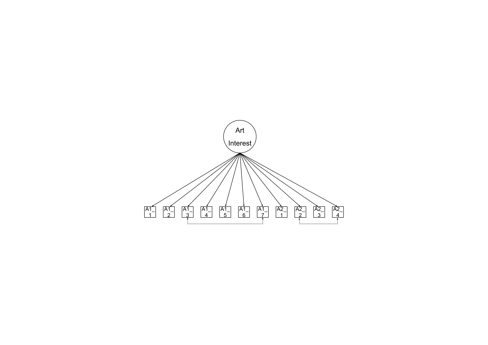

```{r}
library(dplyr)
library(tidyr)
library(ggiraph) # interactive plot
library(htmlwidgets) # interaction online
library(ggplot2)
library(sf) # world map
library(patchwork)
```

# Introduction

```{r, results='hide', fig.show='hide'}

data = read.csv("International_vaiak.csv")

```

The VAIAK is composed by two scales, the Art Interest (AI) and the Art Knowledge (AK). The two scales measure two distinctive constructs, thus the analysis will be carry out separetely.

The purpose of the study is to carry out analysis to observe the how the items and the scale more in general behave across multiple populations and contexts. Research analysing the VAIAK already exist, with multiple validations, IRT, CFA, etc. I created a folder with the paper (some where written in a different language so I translated them).

For each scale we have collected the following factors:

-   Medium, e.g., computer, pen and paper, smartphone
-   Setting, e.g., lab, museums, classrooms
-   Country
-   Languages
-   Expertise, two levels lay people and experts. The past CFA analysis show a different results between the levels fo the factor, which can be important if we find difference in the Multigroup CFA for the other factors (Medium, setting), because we do not have equal samples of experts across those.

# Art Interest

Art Interest (AI) is composed by 11 items. These are either about subjective interest (e.g., I am interested in art) or behaviors (e.g., I go to visit art exhibitions). Each item is rated on a 7-point Likert scale. Items of subjective interest are rated from “not at all” (1) to “very much” (7), while behavioral items range from “less than once a year” (1) to “once a week or more often” (7). Only one scale is consider, and no subscale is measured.

Only participants who have completed the complete scale are taken into account.

```{r, results='hide', fig.show='hide'}

data_ai = data %>%
    filter(
      if_all(AI_1_1:AI_2_4, ~ !is.na(.x))) %>%
  mutate(
    ID_Database = factor(ID_Database))

```

## General analysis

The total number fo entries is 14747. For the total sample I plan two series of analysis:

-   Internal consistency with McDonald omega

-   I do not plan to carry out an EFA. This is because a tested theoretical model is already present in the literature. In line with the recomendation from Henson and Robert (2006): "When prior theory exists regarding the structure of the data, CFA should be considered as an alternative to EFA"

-   CFA, given that we are talking about a 7 points-Likerts scale, we will adopt the robust maximum likelihood estimator (MLR) as a estimation method. I would proposed a one-factor model, what the theory expect, but also a two-factor model, with items divided the scale into the subjective_interest and behavioral_interest. This is because from my prior analysis (of the Italian data set) and the prior CFA from Specker (2024) the behavioral_interest present high correlation residuals. An alternative (and an open question) is whether to carry out the analysis with the "corrected" model, with the additional correlation residuals (following image). The correlations have already been observed in Specker (2024) and the Italian validation and have reasonable theoretical explanations.

    ```         
      {width="33%"}
    ```

-   IRT, adopting a graded response model (GRM)

## Multigroup analysis

For the differnt factors I plan to carry out Multigroup CFA to check if we can ensure equivalence across the mediums, settings, languages and countries. For each factor I present the number of levels and the participants.

### Medium

```{r}

data_ai_medium = data_ai %>%
  count(Sett_Medium, name = "n") %>%
  filter(!is.na(Sett_Medium))

graph_ai = ggplot(data_ai_medium, aes(y = n, x = reorder(Sett_Medium, n),
                                tooltip = paste0(Sett_Medium, ": ", n), 
                                data_id = Sett_Medium)) +
  geom_col_interactive(fill = "grey70",
                        hover_css = "fill:#ff193b; 
                       stroke:black; 
                       stroke-width:1.5px;") +
  theme_minimal() +
  labs(title = "Variable : Medium in AI scale")  +
  theme(
    axis.text.y = element_blank(),
    axis.ticks.y = element_blank(),
    axis.title.x = element_blank(),
    axis.title.y = element_blank(),
    legend.position = "none")

girafe(ggobj = graph_ai) 
```

### Settings

```{r}

data_ai_context = data_ai %>%
  count(Sett_Context, name = "n") %>%
  filter(!is.na(Sett_Context))

graph_ai = ggplot(data_ai_context, aes(y = n, x = reorder(Sett_Context, n),
                                tooltip = paste0(Sett_Context, ": ", n), 
                                data_id = Sett_Context)) +
  geom_col_interactive(fill = "gray70",
                        hover_css = "fill:#ff193b; 
                       stroke:black; 
                       stroke-width:1.5px;") +
  theme_minimal() +
  labs(title = "Variable : Context in AI scale")  +
  theme(
    axis.text.y = element_blank(),
    axis.ticks.y = element_blank(),
    axis.title.x = element_blank(),
    axis.title.y = element_blank(),
    legend.position = "none")

girafe(ggobj = graph_ai) 
```

### Languages

```{r}

data_ai_language = data_ai %>%
  count(Sett_Language, name = "n") %>%
  filter(!is.na(Sett_Language))

graph_ai = ggplot(data_ai_language, aes(y = n, x = reorder(Sett_Language, n),
                                tooltip = paste0(Sett_Language, ": ", n), 
                                data_id = Sett_Language)) +
  geom_col_interactive(fill = "gray70",
                        hover_css = "fill:#ffb600; 
                       stroke:black; 
                       stroke-width:1.5px;") +
  theme_minimal() +
  labs(title = "Variable : Language in AI scale")  +
  theme(
    axis.text.y = element_blank(),
    axis.ticks.y = element_blank(),
    axis.title.x = element_blank(),
    axis.title.y = element_blank(),
    legend.position = "none")

girafe(ggobj = graph_ai) 
```

### Country of origin

Across the country it may be argue that people inside the less industrialised countries do not have the same access to art activities. However from the sample we do not have enough participants from non-industrialised countries.

The following map represents only the country with at least 5 participants.

```{r}

world_sf = read_sf("https://raw.githubusercontent.com/holtzy/R-graph-gallery/master/DATA/world.geojson")

data_ai_country = data_ai %>%
  count(Dem_Country, name = "n") %>%
  filter(n>5) %>%
  filter(!is.na(Dem_Country))

world_sf = world_sf %>%
    filter(!name %in% c("Antarctica", "Greenland"))  %>%
  left_join(data_ai_country, by = c("name" = "Dem_Country")) 

graph_ai_country_1 = ggplot(world_sf, aes(
  x = reorder(name, n),
  y = n,
  tooltip = paste0(name, ":", n),
  data_id = name,
  fill = "gray70")) +
  geom_col_interactive(data = filter(world_sf, !is.na(n)), 
                       fill = "gray70",
                        hover_css = "fill:#f20089; 
                       stroke:black; 
                       stroke-width:1.5px;") +
  theme_minimal() +
    coord_flip() + 
  theme(
    axis.text.y = element_blank(),
    axis.ticks.y = element_blank(),
    axis.title.x = element_blank(),
    axis.title.y = element_blank(),
    legend.position = "none")

graph_ai_country_2 = ggplot() +
  geom_sf(data = world_sf, fill = "lightgrey", color = "lightgrey") +
    geom_sf_interactive(
      data = filter(world_sf, !is.na(n)),
    aes(tooltip = paste0(name, ":", n), 
        data_id = name), 
        fill = "gray70") +
  coord_sf(crs = st_crs(3857)) +
  theme_void() +
  theme(
    axis.title.x = element_blank(),
    axis.title.y = element_blank(),
    legend.position = "none")

combined_ai_country = graph_ai_country_1 / graph_ai_country_2 + plot_layout(heights = c(2,2))

interactive_plot = girafe(ggobj = combined_ai_country, 
                            width_svg = 10, height_svg = 14)

interactive_plot = girafe_options(
  interactive_plot,
  opts_hover(css = "fill:red;stroke:black;"))

interactive_plot
```

### Expertise

As sad before, the above factors have unequal amount of experts and lay people, and the different in the Multigroup CFA may also be explained by the expertise factor, which have already shown to lead to difference in the factor loadings.

```{r}

data_ai_expertise = data_ai %>%
  count(ArtExp_Expertise_cluster, name = "n") %>%
  filter(!is.na(ArtExp_Expertise_cluster))

graph_ai = ggplot(data_ai_expertise, aes(y = n, x = reorder(ArtExp_Expertise_cluster, n),
                                tooltip = paste0(ArtExp_Expertise_cluster, ": ", n), 
                                data_id = ArtExp_Expertise_cluster)) +
  geom_col_interactive(fill = "gray70",
                        hover_css = "fill:#001d59; 
                       stroke:black; 
                       stroke-width:1.5px;") +
  theme_minimal() +
  labs(title = "Variable : Expertise level in AI scale")  +
  theme(
    axis.text.y = element_blank(),
    axis.ticks.y = element_blank(),
    axis.title.x = element_blank(),
    axis.title.y = element_blank(),
    legend.position = "none")

girafe(ggobj = graph_ai) 
```

# References

Henson, R. K., & Roberts, J. K. (2006). Use of exploratory factor analysis in published research: Common errors and some comment on improved practice. Educational and Psychological measurement, 66(3), 393-416.

Specker, E. (2024). Further validating the VAIAK: Defining a psychometric model, configural measurement invariance, reliability, and practical guidelines. Psychology of Aesthetics, Creativity, and the Arts, 18(3), 449.
